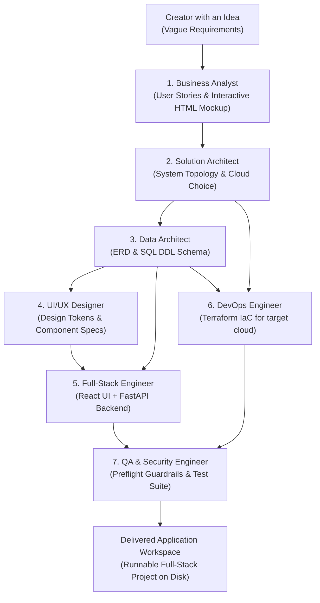

# Nexus: Orchestrator-Native AI Agentic Framework

<p align="center">
  <a href="https://pypi.org/project/nexus-agent-framework/"></a>
  <a href="https://www.npmjs.com/org/nexus-agent-framework"></a>
  <a href="https://pypi.org/project/nexus-agent-framework/"></a>
  <a href="https://opensource.org/licenses/Apache-2.0"></a>
  <a href="https://github.com/sabburi1994/nexus/actions"></a>
</p>

> **Nexus** is an autonomous AI agentic software engineering framework that transforms requirements into production-ready full-stack applications. It provisions a full virtual IT department (BA, Solution Architect, Data Architect, UI Designer, Full-Stack Engineer, DevOps, and QA) and connects natively with **Claude Code, Cursor, Codex, and Gemini** via the Model Context Protocol (MCP).

---

## 🚀 Installation & Quickstart

### Python Framework (PyPI)
Install the core orchestrator and agent runtime:
```bash
pip install nexus-agent-framework
```

### TypeScript / React Packages (npm)
Install individual enterprise contracts, UI components, and security middleware:
```bash
npm install @nexus-agent-framework/contracts
npm install @nexus-agent-framework/middleware
npm install @nexus-agent-framework/scraper
npm install @nexus-agent-framework/ui
```

---

## 🏛️ The Nexus Virtual IT Squad

Nexus simulates a real-world software engineering organization with 7 autonomous specialists working sequentially to deliver end-to-end applications:



### Specialist Responsibilities
1. **Business Analyst (`BusinessAnalystAgent`)**: Synthesizes ideas into a canonical slug, value proposition, user stories, and an interactive HTML wireframe preview (`docs/preview_mockup.html`).
2. **Solution Architect (`SolutionArchitectAgent`)**: Evaluates cloud runtime topology (Cloud Run serverless containers vs Always-Free VM), networking, and latency budgets.
3. **Data Architect (`DataArchitectAgent`)**: Normalizes relational schemas, foreign keys, indexes, and emits PostgreSQL SQL DDL (`docs/DATA_ARCHITECTURE.md`).
4. **UI/UX Designer (`UiDesignerAgent`)**: Produces responsive design tokens and Tailwind component structures utilizing `@nexus-agent-framework/ui`.
5. **Full-Stack Engineer (`FullStackEngineerAgent`)**: Implements clean FastAPI REST endpoints, Pydantic validation schemas, SQLAlchemy ORM entities, and React UI components.
6. **DevOps Engineer (`DevopsEngineerAgent`)**: Generates production Infrastructure as Code (Terraform `main.tf`, `variables.tf`), container definitions (`Dockerfile`, `docker-compose.yml`), and CI/CD pipelines.
7. **QA & Security Engineer (`QaEngineerAgent`)**: Executes pre-flight security scans (injection sanitization, CORS, credential checks) and delivers an executable `pytest` suite with 100% pre-flight clearance.

---

## 📦 Ecosystem Packages

Nexus is maintained as a unified monorepo providing full-stack libraries across PyPI and npm:

| Package | Registry | Version | Capabilities |
| :--- | :--- | :--- | :--- |
| **[`nexus-agent-framework`](https://pypi.org/project/nexus-agent-framework/)** | PyPI | `0.1.1` | Core orchestrator, 7 specialist agents, CLI (`dream`, `mcp`, `ui`), cost tracker |
| **[`@nexus-agent-framework/contracts`](https://www.npmjs.com/package/@nexus-agent-framework/contracts)** | npm | `1.0.2` | Telemetry schemas, agent audit chains, and architectural contracts |
| **[`@nexus-agent-framework/middleware`](https://www.npmjs.com/package/@nexus-agent-framework/middleware)** | npm | `1.0.1` | Hardened security headers, zero-leak credential sanitizer, correlation tracing |
| **[`@nexus-agent-framework/scraper`](https://www.npmjs.com/package/@nexus-agent-framework/scraper)** | npm | `1.0.1` | Polite web scraping protocols, RSS feed ingestion, rate limits & backoff policies |
| **[`@nexus-agent-framework/ui`](https://www.npmjs.com/package/@nexus-agent-framework/ui)** | npm | `0.1.1` | React design system (`StatCard`, `AiBadge`, `MetricTrend`, `TraceViewer`) |

---

## 🔌 Orchestrator-Native: Claude Code, Cursor & Gemini Integration

Nexus exposes its entire agent runtime and tooling to AI code editors via the **Model Context Protocol (MCP)**:

```bash
# Launch Nexus as an MCP server
nexus mcp
```

### Editor Configuration (`.cursor/mcp.json` or `claude_desktop_config.json`)
```json
{
  "mcpServers": {
    "nexus": {
      "command": "nexus",
      "args": ["mcp"],
      "env": {
        "GCP_PROJECT_ID": "your-gcp-project-id"
      }
    }
  }
}
```
Claude Code and Cursor gain native access to all 7 specialist agents, architectural tools, and database schema generators directly within your prompt session.

---

## ⚡ Instant Application Generation: `nexus dream`

Generate complete, runnable applications from natural language:

```bash
nexus dream "I want an app that tracks second-hand luxury watches in Europe with price alerts"
```

```text
--- Nexus Core IT Squad Activated ---
Goal: "I want an app that tracks second-hand luxury watches in Europe with price alerts"
Assignees: Business Analyst, Engineering Manager, UI/UX Designer, Backend Engineer, QA Engineer

=== Project Delivered! ===
App: WatchHub (watchhub)
Tagline: Verified European luxury watch index and real-time deal alerts
Output Directory: ./watchhub
Stories: 4 user stories defined
Cloud Target: GCP (Cloud Run Serverless)
Data Schema: PostgreSQL 16 (4 tables)
UI Component: WatchDashboard.tsx
QA Preflight: PASS (Test suite generated with 100% pre-flight clearance)
```

---

## 🖥️ Local Observability Dashboard: `nexus ui`

Launch the real-time execution dashboard on `http://localhost:8000`:

```bash
nexus ui
```

- **Visual Pipeline**: Real-time status indicators across the 7 specialists.
- **Server-Sent Telemetry**: Live stream of agent thoughts, tool invocations, and model reasoning.
- **Cost & Budget Meter**: Live dollar spend calculation against Gemini 3.8 pricing models.
- **Interactive Wireframe Viewer**: Preview generated HTML mockups and explore generated FastAPI/React code.

---

## 🛡️ Built-in Cost & Security Guardrails

- **Hard Budget Caps**: Strict `max_budget_usd` ceilings per execution context.
- **Cost-Optimized Model Tiering**: Ultra-fast, highly economical token profile with Gemini 3.8 Flash.
- **Jailbreak Defense**: Pre-flight filters detecting and neutralizing prompt injection attempts.
- **Zero-Leak Secret Scrubbing**: Automated redaction of API keys (`sk-...`, `ghp-...`, private keys) from all logs and telemetry streams.
- **Deterministic Mock Engine**: Run the entire IT pack and test suite locally for \$0.00 using `MockProvider`.

---

## 🧪 Verification & Testing

Nexus includes automated unit tests covering all agents, telemetry contracts, and CLI commands:

```bash
git clone https://github.com/sabburi1994/nexus.git
cd nexus
pytest -o pythonpath=src tests/
```
```text
tests/test_agents.py .................. [100%]
============================== 20 passed in 1.42s ==============================
```

---

## 🤝 Governance & Feature Requests

Nexus is free for everyone to use, run, and explore. To preserve strict architectural consistency, contracts, and quality gates:

- **Nexus is maintained exclusively by the author.** External pull requests are disabled and will not be accepted.
- **Have an idea or need a feature?** We warmly welcome your feedback! Please submit feature requests, questions, or bug reports via [GitHub Issues](https://github.com/sabburi1994/nexus/issues).

---

## 📄 License
Nexus is licensed under the [Apache 2.0 License](LICENSE).  
Copyright © 2026 Sai Nikhil Abburi. All rights reserved.
