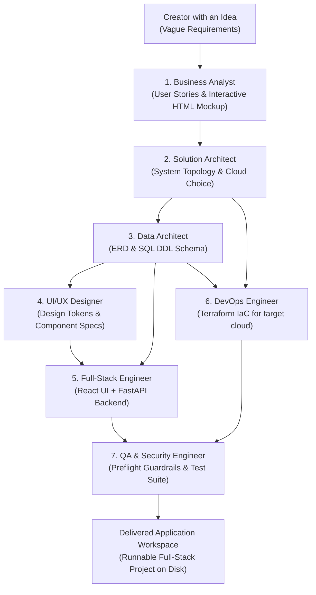

# Nexus: Orchestrator-Native AI Agentic Framework

> The **AI Agentic Framework** that equips non-technical creators with a full virtual IT department while interfacing natively with **Claude Code, Cursor, Codex, and Gemini** via the Model Context Protocol (MCP).

Nexus bridges the gap between raw ideas and production code. It serves two distinct developer cohorts:
1. **Beginners with Ideas**: Run `nexus dream "<vague idea>"` and the **Core IT Pack** (BA, Solution Architect, Data Architect, UI/UX Designer, Full-Stack Engineer, DevOps Engineer, and QA) takes the idea, designs the UI mockup, normalizes the relational schema, writes the full-stack code, generates Terraform IaC, and runs automated tests.
2. **AI Orchestrator Users (Claude Code, Cursor, Codex, Gemini)**: Run `nexus mcp` to expose your agents, tools, databases, and guardrails to any modern AI IDE as first-class, equal participants.

---

## 🚀 Quickstart & Installation

```bash
pip install nexus-agent-framework
```

---

## 🏛️ The Nexus Core IT Pack

Nexus comes pre-packaged with an autonomous IT squad that simulates a real-world software engineering organization:



### 1. Business Analyst (`BusinessAnalystAgent`)
Takes conversational, incomplete user thoughts and formats them into a crisp **Product Proposal**:
- Canonical app slug & value proposition tagline.
- User stories (`As a [user], I want to [action] so that [benefit]`).
- Core features specification & interactive HTML wireframe preview (`docs/preview_mockup.html`).

### 2. Solution Architect (`SolutionArchitectAgent`)
Evaluates holistic system design, integration boundaries, and non-functional requirements:
- Selects the cloud runtime strategy (GCP, AWS, or Local).
- Defines compute model (Cloud Run serverless container vs Always-Free VM).
- Details service communication topology and latency budgets.

### 3. Data Architect (`DataArchitectAgent`)
Designs the relational and persistence architecture:
- Normalizes tables, foreign keys, and indexes.
- Emits clean, production-ready PostgreSQL SQL DDL schemas (`docs/DATA_ARCHITECTURE.md`).

### 4. UI/UX Designer (`UiDesignerAgent`)
Focuses on user journey, design tokens, and interactive mockups styled with Tailwind CSS and `@abburi/ui`.

### 5. Full-Stack Engineer (`FullStackEngineerAgent`)
Implements the unified end-to-end codebase:
- Production-grade FastAPI microservice with Gemini 3.8 client (`backend/src/main.py`).
- Pydantic models & SQLAlchemy entity definitions (`backend/src/models.py`).
- React frontend consuming the API endpoints (`frontend/src/App.tsx`).

### 6. DevOps Engineer (`DevopsEngineerAgent`)
Generates real Infrastructure as Code (IaC) tailored to the architectural need and selected cloud:
- Complete Terraform `main.tf` and `variables.tf` (e.g. Cloud Run, IAM `roles/aiplatform.user`, Secret Manager).
- Multi-container `docker-compose.yml` for local development.
- GitHub Actions CI/CD deployment pipeline (`.github/workflows/deploy.yml`).

### 7. QA & Security Engineer (`QaEngineerAgent`)
Inspects implemented backend routes, runs pre-flight security checks (injection shields, permission levels), and produces an executable `pytest` test suite (`backend/tests/test_api.py`) with 100% pre-flight clearance.

---

## 📦 Shared Monorepo Packages (`packages/`)

Nexus is structured as a monorepo with universal, reusable packages:

| Package | Purpose | Exports / Capabilities |
| :--- | :--- | :--- |
| **`@abburi/ui`** | Shared React UI & Design System | `StatCard`, `AiBadge`, `MetricTrend`, `NexusHeader`, `TraceViewer`, `SecurityShieldBadge` |
| **`@abburi/contracts`** | Universal Spec & Telemetry Contracts | `AgentTelemetryEvent`, `ProductProposalContract`, `SolutionBlueprintContract`, `DataArchitectureContract`, `DevopsSpecificationContract`, `QaSpecificationContract`, `AuditChainEntryContract` |
| **`@abburi/middleware`** | Security & Scrubbing Middleware | `NEXUS_SECURITY_HEADERS`, `scrubSensitiveData` (zero credential leaks), `generateCorrelationId` |
| **`@abburi/scraper`** | Ethical & Resilient Scraping | `ScrapedItem`, `DEFAULT_NEXUS_SCRAPING_POLICY`, rate-limit & backoff policy contracts |

### Centralized Terraform Modules (`infra/terraform/modules/`)
- **`nexus_app`**: Baseline GCP APIs (`aiplatform.googleapis.com`, `secretmanager.googleapis.com`), service accounts, and IAM roles (`roles/aiplatform.user`).
- **`nexus_cloud_run`**: Auto-scaling serverless Cloud Run container module with HTTPS termination and VPC access.
- **`nexus_vm`**: Cost-optimized Always-Free Compute Engine VM module with custom VPC, firewall, IAP SSH, and Docker setup.

---

## 🔌 Orchestrator-Native: Claude Code & Cursor Integration

Nexus is designed to work as an equal peer alongside **Claude Code, Cursor, Codex, and Gemini CLI**:

```bash
# Start the Nexus Model Context Protocol (MCP) server
nexus mcp
```

### Connecting from Cursor / Claude Code
Add Nexus to your `.cursor/mcp.json` or `claude_desktop_config.json`:
```json
{
  "mcpServers": {
    "nexus": {
      "command": "python",
      "args": ["-m", "nexus.cli.main", "mcp"],
      "env": {
        "GCP_PROJECT_ID": "finhub-510316"
      }
    }
  }
}
```
Instantly, Claude Code or Cursor gains access to all Nexus tools, allowing you to trigger IT squad workflows, check AI connections, or diagnose errors right inside your editor prompt.

---

## 🖥️ Localhost Visualizer & Agent Observability (`nexus ui`)

Nexus provides a built-in interactive web visualizer to track your agent squad and execution telemetry in real time:

```bash
# Launch localhost progress visualizer on http://localhost:8000
nexus ui
```

### Features:
- **Visual Squad Pipeline**: Live status indicators for each agent (`Idle`, `Active`, `Done ✓`) as tasks move through the 7 specialists.
- **Real-Time Telemetry Stream**: Server-Sent Events (SSE) feed displaying thoughts, tool calls, and model reasoning.
- **Cost & Budget Meter**: Live dollar spend tracking (`total_cost_usd`) updated after every inference turn against official Gemini 3.8 pricing.
- **Live Artifact Inspector**: Read generated Product Proposals, preview interactive HTML wireframes, and inspect React/FastAPI code directly in your browser.
- **Interactive Launcher**: Trigger new squad builds directly from the web interface.

---

## ⚡ Instant Application Creation: `nexus dream`

```bash
nexus dream "I want an app that tracks second-hand luxury watches in Europe with price alerts"
```

Output:
```text
--- Nexus Core IT Squad Activated ---
Goal: "I want an app that tracks second-hand luxury watches in Europe with price alerts"
Assignees: Business Analyst, Engineering Manager, UI/UX Designer, Backend Engineer, QA Engineer

=== Project Delivered! ===
App: WatchHub (watchhub)
Tagline: Verified European luxury watch index and real-time deal alerts
Output Directory: ./watchhub
Stories: 4 user stories defined
Cloud Target: GCP (Cloud Run Serverless)
Data Schema: PostgreSQL 16 (4 tables)
UI Component: WatchDashboard.tsx
QA Preflight: PASS (Test suite generated with 100% pre-flight clearance)
```

---

## 🛡️ Built-in Cost & Security Guardrails

- **Zero Runaway Bills**: `max_budget_usd` spend ceilings on every agent execution context.
- **Gemini 3.8 Flash Cost Profile**: \$0.075 / \$0.30 per million tokens (cents per month for active squads).
- **Prompt Injection Defense**: Intercepts jailbreaks (`"ignore all prior instructions"`) before hitting the LLM.
- **PII & Secret Scrubber**: Redacts API keys (`sk-...`, `ghp-...`) and credentials automatically.
- **Zero-Cost Mock Engine**: Run the entire IT pack and test suite locally for \$0.00 using `MockProvider`.

---

## 🧪 Verification

```bash
git clone https://github.com/sabburi1994/nexus.git
cd nexus
pytest -o pythonpath=src tests/
```
All 20 unit tests pass cleanly out of the box.
