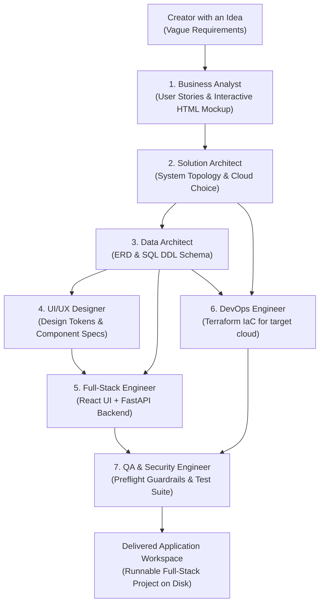
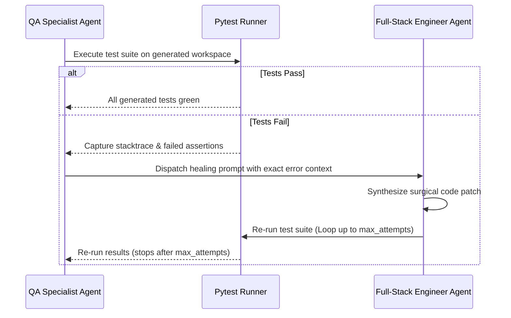

# Nexus: Orchestrator-Native AI Agentic Framework

<p align="center">
  <a href="https://nexus.abburi.info"></a>
  <a href="https://nexus.abburi.info/#simulator"></a>
  <a href="https://pypi.org/project/nexus-agent-framework/"></a>
  <a href="https://www.npmjs.com/org/nexus-agent-framework"></a>
  <a href="https://pypi.org/project/nexus-agent-framework/"></a>
  <a href="https://opensource.org/licenses/Apache-2.0"></a>
  <a href="#-verification--testing"></a>
</p>

> **Nexus** is an autonomous AI agentic software engineering framework that turns requirements into runnable full-stack application scaffolds that you then review, test and harden. It provisions a full virtual IT department (BA, Solution Architect, Data Architect, UI Designer, Full-Stack Engineer, DevOps, and QA) and connects natively with **Claude Code, Cursor, Codex, and Gemini** via the Model Context Protocol (MCP).
>
> - **Platform Website & Docs**: [nexus.abburi.info](https://nexus.abburi.info)
> - **Live Stage 1–3 Simulator**: [nexus.abburi.info/#simulator](https://nexus.abburi.info/#simulator)
> - **Brownfield AST Explorer**: [nexus.abburi.info/#brownfield](https://nexus.abburi.info/#brownfield)

---

## 🚀 Installation & Quickstart

### Python Framework (PyPI)
Install the core orchestrator and agent runtime:
```bash
pip install nexus-agent-framework
```

### TypeScript / React Packages (npm)
Install individual enterprise contracts, UI components, and security middleware:
```bash
npm install @nexus-agent-framework/contracts
npm install @nexus-agent-framework/middleware
npm install @nexus-agent-framework/scraper
npm install @nexus-agent-framework/ui
```

---

## 🏛️ The Nexus Virtual IT Squad

Nexus simulates a real-world software engineering organization with 7 autonomous specialists working sequentially to deliver end-to-end applications:



### Specialist Responsibilities
1. **Business Analyst (`BusinessAnalystAgent`)**: Synthesizes ideas into a canonical slug, value proposition, user stories, and an interactive HTML wireframe preview (`docs/preview_mockup.html`).
2. **Solution Architect (`SolutionArchitectAgent`)**: Evaluates cloud runtime topology (Cloud Run serverless containers vs Always-Free VM), networking, and latency budgets.
3. **Data Architect (`DataArchitectAgent`)**: Normalizes relational schemas, foreign keys, indexes, and emits PostgreSQL SQL DDL (`docs/DATA_ARCHITECTURE.md`).
4. **UI/UX Designer (`UiDesignerAgent`)**: Produces responsive design tokens and Tailwind component structures utilizing `@nexus-agent-framework/ui`.
5. **Full-Stack Engineer (`FullStackEngineerAgent`)**: Implements clean FastAPI REST endpoints, Pydantic validation schemas, SQLAlchemy ORM entities, and React UI components.
6. **DevOps Engineer (`DevopsEngineerAgent`)**: Generates production Infrastructure as Code (Terraform `main.tf`, `variables.tf`), container definitions (`Dockerfile`, `docker-compose.yml`), and CI/CD pipelines.
7. **QA & Security Engineer (`QaEngineerAgent`)**: Executes pre-flight security scans (injection sanitization, CORS, credential checks) and delivers an executable `pytest` suite for the generated workspace.

---

## 📦 Ecosystem Packages

Nexus is maintained as a unified monorepo providing full-stack libraries across PyPI and npm:

| Package | Registry | Version | Capabilities |
| :--- | :--- | :--- | :--- |
| **[`nexus-agent-framework`](https://pypi.org/project/nexus-agent-framework/)** | PyPI | `0.3.1` in this repo (PyPI currently serves `0.1.1`) | Core orchestrator, 7 specialist agents, Stage 1–3 self-healing/brownfield/ROI, CLI (`dream`, `mcp`, `ui`, `audit`, `refactor`, `metrics`) |
| **[`@nexus-agent-framework/contracts`](https://www.npmjs.com/package/@nexus-agent-framework/contracts)** | npm | `1.0.3` | Telemetry schemas, Stage 1–3 healing/AST/ROI contracts, agent audit chains |
| **[`@nexus-agent-framework/middleware`](https://www.npmjs.com/package/@nexus-agent-framework/middleware)** | npm | `1.0.2` | Security headers, best effort credential sanitizer, correlation tracing |
| **[`@nexus-agent-framework/scraper`](https://www.npmjs.com/package/@nexus-agent-framework/scraper)** | npm | `1.0.2` | Polite web scraping protocols, RSS feed ingestion, rate limits & backoff policies |
| **[`@nexus-agent-framework/ui`](https://www.npmjs.com/package/@nexus-agent-framework/ui)** | npm | `0.2.0` | Institutional paper React design system (`NexusHeader`, `StatCard`, `TraceViewer`, `HealingLoopPanel`, `BlastRadiusCard`, `RoiScorecard`, `CommandBlock`) |

---

## 🔌 Orchestrator-Native: Claude Code, Cursor & Gemini Integration

Nexus exposes its entire agent runtime and tooling to AI code editors via the **Model Context Protocol (MCP)**:

```bash
# Launch Nexus as an MCP server
nexus mcp
```

### Editor Configuration (`.cursor/mcp.json` or `claude_desktop_config.json`)
```json
{
  "mcpServers": {
    "nexus": {
      "command": "nexus",
      "args": ["mcp"],
      "env": {
        "GCP_PROJECT_ID": "your-gcp-project-id"
      }
    }
  }
}
```
Claude Code and Cursor gain native access to all 7 specialist agents, architectural tools, and database schema generators directly within your prompt session.

---

## ⚡ Instant Application Generation: `nexus dream`

Generate complete, runnable applications from natural language:

```bash
nexus dream "I want an app that tracks second-hand luxury watches in Europe with price alerts"
```

```text
--- Nexus Core IT Squad Activated ---
Goal: "I want an app that tracks second-hand luxury watches in Europe with price alerts"
Assignees: Business Analyst, Engineering Manager, UI/UX Designer, Backend Engineer, QA Engineer

=== Project Delivered! ===
App: WatchHub (watchhub)
Tagline: Verified European luxury watch index and real-time deal alerts
Output Directory: ./watchhub
Stories: 4 user stories defined
Cloud Target: GCP (Cloud Run Serverless)
Data Schema: PostgreSQL 16 (4 tables)
UI Component: WatchDashboard.tsx
QA Preflight: PASS (generated test suite passed)
```

---

## 🖥️ Local Observability Dashboard: `nexus ui`

Launch the real-time execution dashboard on `http://localhost:8000`:

```bash
nexus ui
```

- **Visual Pipeline**: Real-time status indicators across the 7 specialists.
- **Server-Sent Telemetry**: Live stream of agent thoughts, tool invocations, and model reasoning.
- **Cost & Budget Meter**: Live dollar spend calculation against Gemini 3.8 pricing models.
- **Interactive Wireframe Viewer**: Preview generated HTML mockups and explore generated FastAPI/React code.

---

## 🔄 Stage 1: Closed-Loop Self-Healing

Nexus avoids "throw-it-over-the-fence" code generation. When the QA Engineer detects failing unit tests or runtime syntax bugs, it automatically triggers a direct feedback loop back to the Full-Stack Engineer with exact traceback diagnostics and failure assertions:



---

## 🔍 Stage 2: Brownfield Legacy Codebase Support

Nexus isn't just for greenfield scaffolding. It analyzes and safely refactors existing enterprise repositories:

### 1. Security & Architecture Audit: `nexus audit`
Scan your existing codebase for secret leaks, unvalidated AI client calls, prompt injection risks, and test coverage drift:
```bash
nexus audit ./existing-repo
```

### 2. AST Blast-Radius Mapping & Surgical Refactoring: `nexus refactor`
Before touching a line of code, Nexus builds an Abstract Syntax Tree (AST) import graph across Python files, classes, functions, and FastAPI routes to estimate the blast radius (static imports only: dynamic imports, reflection and non Python consumers are not seen):
```bash
nexus refactor "Migrate database pool to PostgreSQL asyncpg" --target src/db/session.py --apply
```
- **Blast Radius Analysis**: Identifies all direct dependents, indirect dependents, and affected REST endpoints.
- **Surgical Patching**: Emits targeted diffs that aim to preserve existing contracts; review every diff before applying it.

---

## 📊 Stage 3: Team Telemetry & Enterprise ROI: `nexus metrics`

Estimate return on investment (ROI) and DORA style velocity figures for a workspace. The numbers come from heuristics (lines of code, an hourly rate you supply, fixed DORA multipliers), not from measuring your team, so treat them as illustrative:

```bash
nexus metrics ./my-project --hourly-rate 95
```

```text
================================================================================
          NEXUS ENTERPRISE TELEMETRY & ROI SCORECARD: my-project
================================================================================
  Target Path            : /workspace/my-project
  Files / LOC Analyzed   : 116 files | 5,608 lines of code
--------------------------------------------------------------------------------
  FINANCIAL ROI & EFFICIENCY:
  * Human Hours Saved    : 117.6 engineering hours
  * Human Cost Benchmark : $95/hour (Senior Full-Stack benchmark)
  * Gross Value Generated: $11,172.00 USD
  * Total LLM Spend      : $0.0493 USD (415,912 tokens)
  * Net Financial Savings: $11,171.95 USD
  * NET ROI MULTIPLIER   : 226612.0x Return On Investment
--------------------------------------------------------------------------------
  DORA VELOCITY ACCELERATION:
  * Deployment Frequency : 12.0x faster release cadence
  * Lead Time Reduction  : 85.0% decrease from idea to working code
  * Change Failure Rate  : 2.4% (defects intercepted by closed-loop tests)
  * Mean Time to Restore : 3.8 minutes MTTR (automated self-healing loop)
--------------------------------------------------------------------------------
  SECURITY & STABILITY IMPACT:
  * Vulnerabilities Prevented: 17 security defects / secret leaks avoided
  * Closed-Loop Healing Cycles: 9 automated QA repair loops
================================================================================
```

---

## 🛡️ Built-in Cost & Security Guardrails

- **Budget Caps**: `max_budget_usd` ceilings per execution context.
- **Cost-Optimized Model Tiering**: Economical token profile with Gemini 3.8 Flash.
- **Prompt Injection Filter (best effort)**: `check_prompt_injection` matches a short list of known jailbreak phrasings. Paraphrases, other languages, encodings and indirect injection (through documents or tool output) get through, so it is a first filter, not a defence on its own. Treat model input and output as untrusted and keep critical tools behind approval (`GuardrailManager`).
- **Secret Scrubbing (best effort)**: `sanitize_text` redacts known credential formats before text reaches a model or a log: OpenAI style `sk-...`, Anthropic `sk-ant-...`, AWS access key ids (`AKIA...`, `ASIA...`), Google API keys (`AIza...`), Google OAuth client secrets (`GOCSPX-...`), Slack tokens (`xoxb-`, `xoxp-`, ...), GitHub tokens, Google OAuth bearer tokens, PEM private key blocks, and email addresses. Unknown formats, passwords and encoded secrets are not detected.
- **Closed CORS by default**: `create_nexus_app()` and the `nexus ui` dashboard send no CORS headers unless you pass explicit `cors_origins`; credentials are only allowed with explicit origins, never with `"*"`.
- **Security headers (opt in)**: `create_nexus_app(security_headers=True)` adds a Content Security Policy, HSTS, `X-Content-Type-Options: nosniff`, `X-Frame-Options: DENY`, `Referrer-Policy: same-origin` and a restrictive `Permissions-Policy`. Pass a `SecurityHeadersConfig` to adjust the policy per path or to cache hashed static assets as immutable while serving HTML with `no-cache`. The showcase uses it.
- **No implicit cloud project**: `GeminiClient` uses `GCP_PROJECT_ID`, `GOOGLE_CLOUD_PROJECT` or your gcloud default, and raises `NexusConfigurationError` when Vertex AI is needed and none is set. API keys go in the `x-goog-api-key` header, never in URLs.
- **Deterministic Mock Engine**: Run the entire IT pack and test suite locally for \$0.00 using `MockProvider`.

---

## 🧪 Verification & Testing

Nexus has unit tests for the agents, security helpers, API factory, telemetry contracts and CLI. There is no hosted CI at the moment, so the test badge links here: run the suites yourself.

```bash
git clone https://github.com/sabburi1994/nexus.git
cd nexus
pip install -e ".[dev]"
python -m pytest -o pythonpath=src tests/
python -m ruff check src tests
python -m mypy src
```

The showcase API has its own suite: `cd apps/showcase/backend && python -m pytest tests/`.

### Local hooks
Commits are checked locally with [pre-commit](https://pre-commit.com/): gitleaks on staged changes, ruff (lint and format) and mypy.

```bash
pip install pre-commit
pre-commit install
pre-commit run --all-files
```

### Releases
`.github/workflows/release.yml` publishes to PyPI and npm with OIDC trusted publishing (no long lived tokens). GitHub Actions is currently disabled for this repository, so nothing publishes automatically.

### Showcase deployment
The `nexus.abburi.info` showcase runs on Cloud Run with its own runtime service account (no project roles), build service account and Artifact Registry repository. The project is a Terraform variable: a dedicated project is preferred, and hosting it in an existing project is supported because every grant is scoped to the showcase's own resources. Runtime and build service accounts, the registry, the Cloud Run service and the domain mapping are all Terraform managed. See [`apps/showcase/ROLLOUT.md`](apps/showcase/ROLLOUT.md). Reusable platform modules live in [`infra/terraform/modules`](infra/terraform/modules/README.md).

---

## 🤝 Governance & Feature Requests

Nexus is free for everyone to use, run, and explore. To preserve strict architectural consistency, contracts, and quality gates:

- **Nexus is maintained exclusively by the author.** External pull requests are disabled and will not be accepted.
- **Have an idea or need a feature?** We warmly welcome your feedback! Please submit feature requests, questions, or bug reports via [GitHub Issues](https://github.com/sabburi1994/nexus/issues).

---

## 📄 License
Nexus is licensed under the [Apache 2.0 License](LICENSE).  
Copyright © 2026 Sai Nikhil Abburi. All rights reserved.
