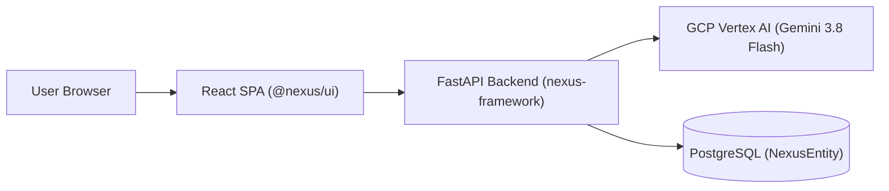

# Nexus Showcase Architecture

## Overview
Nexus Showcase is a reference full-stack application built upon the **Nexus AI Agentic Framework**. It demonstrates how an application inside a monorepo workspace integrates with the shared TypeScript packages, centralized Terraform infrastructure, and Vertex AI Gemini 3.8 Flash.

## Consumed Monorepo Packages
- **`@nexus/ui`**: `NexusHeader`, `AiBadge`, `StatCard`, `TraceViewer`, `SecurityShieldBadge`
- **`@nexus/contracts`**: Universal agent telemetry and spec schema definitions
- **`@nexus/middleware`**: Production security headers and zero-leak credential sanitizer
- **`nexus-framework`**: `create_nexus_app` factory, `GeminiClient`, and `NexusEntity` persistence

## Infrastructure
- **Module**: `infra/terraform/modules/nexus_cloud_run`
- **IAM**: `roles/aiplatform.user` granted via `infra/terraform/modules/nexus_app`
- **Cloud Target**: Serverless auto-scaling Cloud Run container in `europe-west1`
