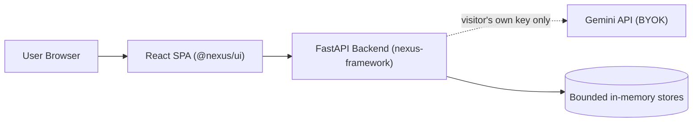

# Nexus Showcase Architecture

## Overview
Nexus Showcase is a reference full-stack application built upon the **Nexus AI Agentic Framework**. It demonstrates how an application inside a monorepo workspace integrates with the shared TypeScript packages, centralized Terraform infrastructure, and Vertex AI Gemini 3.8 Flash.

## Consumed Monorepo Packages
- **`@nexus/ui`**: `NexusHeader`, `AiBadge`, `StatCard`, `TraceViewer`, `SecurityShieldBadge`
- **`@nexus/contracts`**: Universal agent telemetry and spec schema definitions
- **`@nexus/middleware`**: Production security headers and zero-leak credential sanitizer
- **`nexus-framework`**: `create_nexus_app` factory, `GeminiClient`, and `NexusEntity` persistence

## Infrastructure
- **Project**: `project_id` (no default). A dedicated project is preferred; an existing project is
  supported, since every grant is scoped to the showcase's own service accounts, repository and bucket.
- **Terraform**: `apps/showcase/infra/terraform`, using `infra/terraform/modules/nexus_app` and `nexus_cloud_run`.
- **IAM**: runtime account `nexus-showcase-run` with no project roles (no server side model calls);
  build account `nexus-showcase-build` may push only to the app's own Artifact Registry repository and
  read only its own source staging bucket.
- **Cloud Run**: `europe-west1`, min 0, max 2, 512Mi, CPU only during requests, non-root container.
- **Abuse controls**: per IP rate limits on scan, simulate, brownfield and download routes; scan
  reports are visible only to the visitor who created them; credentials are redacted from logs.
- **Security headers**: served through `NexusSecurityHeadersMiddleware`: CSP (only Google Fonts added to
  the default policy), HSTS, nosniff, `X-Frame-Options: DENY`, `Referrer-Policy: same-origin`;
  hashed `/assets/*` are cached immutably, HTML is `no-cache`.
- **Rollout**: see [`../ROLLOUT.md`](../ROLLOUT.md).
