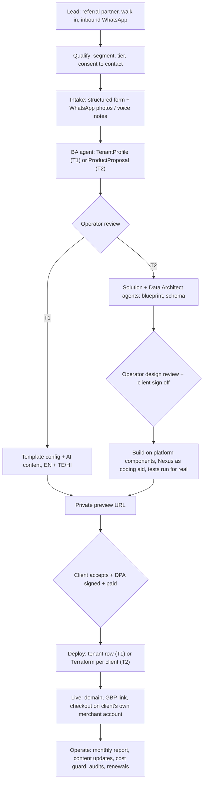

# 2. Delivery architecture

## 2.1 Principle: Nexus builds the product once, the product serves every client

Nexus today is a **developer tool**: given an idea, the 7 role squad produces a scaffold on disk
for an engineer to review (`NexusITTeam.build_from_idea`, `src/nexus/teams/it_pack/team.py:66`).
It is not a tenant platform, it does not deploy, and its output is not production ready without
review. Using it to generate a separate app for each 4,999 INR client would multiply review,
security patching and hosting work by the number of clients.

So the delivery model splits in two:

* **Tier 1 (many small clients):** one multi tenant **storefront product** with a handful of
  vertical templates, built once by the operator with Nexus as a coding aid. A client is a row of
  configuration and content, not a codebase. AI is used for content (copy, translation, catalogue
  extraction from photos, review reply drafts), always with operator approval.
* **Tier 2 (few larger clients):** a real software engagement. Nexus's BA, Architect and Data
  Architect agents draft requirements and design; the operator reviews; code is built on the same
  platform components (portal template, assistant service, Terraform modules) and deployed per
  client.

## 2.2 One engagement end to end

| Stage | Tier 1 | Tier 2 |
|---|---|---|
| **Intake** | 10 minute form (business facts, hours, services or products, prices, languages, photos with rights confirmed, WhatsApp number, consent to process). WhatsApp voice notes transcribed. | Discovery workshop (paid): processes, documents, systems, data sensitivity, users, volumes. |
| **BA agent** | New `TenantProfile` schema: vertical, sections, catalogue items, FAQs, bilingual copy. Today's `ProductProposal` (`src/nexus/teams/it_pack/ba.py:10`) is shaped for new apps, not for a shop. | `ProductProposal` + user stories fits; needs a clarification loop and Telugu / Hindi input. |
| **Architect agents** | Not used per client: the template already fixes the architecture. | `SolutionArchitectAgent` and `DataArchitectAgent` draft topology and schema; must be constrained to the platform (Nexus modules, shared Cloud SQL, max 2 instances). |
| **Generated app** | No per client code. Template renders from config; static pages pre rendered for speed. | Code built from the portal and assistant templates; Nexus FullStack output used only as a starting draft. |
| **Review** | Operator checks content, translations, prices, photos, legal pages (5 to 10 minutes per client). | Code review, real test run, security audit (`nexus audit`), client UAT. |
| **Deploy** | Tenant row + domain mapping; no new service. | Terraform root per client using `nexus_cloud_run`, `nexus_cloud_run_job`, per tenant database. |
| **Maintain** | Platform wide releases; client edits via WhatsApp or portal; monthly report. | Retainer: changes, model updates, usage reports, quarterly audit. |

## 2.3 What exists in Nexus today, what is demo, what must be built

### Real and usable now

| Capability | Where | Notes |
|---|---|---|
| Structured LLM calls with Pydantic schemas | `src/nexus/providers/base.py`, `src/nexus/providers/vertex.py`, `src/nexus/ai/client.py` | Gemini on Vertex AI only. Good base for the content and intake agents. |
| BA, Solution Architect, Data Architect agents | `src/nexus/teams/it_pack/ba.py`, `solution_architect.py`, `data_architect.py` | Single prompt each, English only, no clarification loop. Useful drafts for Tier 2. |
| FastAPI app factory with security headers, closed CORS | `src/nexus/api/app.py`, `src/nexus/api/security_headers.py` | Use for the storefront and portal services. |
| Secret scrubbing and prompt injection first filter | `src/nexus/security/sanitizer.py`, `src/nexus/security/injection.py`, `src/nexus/security/guardrail.py` | Best effort (README says so). WhatsApp and review text is untrusted input; keep tools behind approval. |
| Brownfield audit and blast radius | `src/nexus/brownfield/auditor.py`, `analyzer.py`, `refactor.py` | Useful for Tier 2 clients with existing code, and for auditing the operator's own templates. |
| Terraform platform modules | `infra/terraform/modules/nexus_app`, `nexus_cloud_run`, `nexus_cloud_run_job`, `nexus_cloud_sql` | Production used on the owner's apps. Basis for client hosting (document 3). |
| Reference deployment with scoped IAM | `apps/showcase/infra/terraform/main.tf`, `apps/showcase/ROLLOUT.md` | Pattern for a per client build account, registry and staging bucket. |

### Demo, simulated or misleading if shown to clients

| Item | Where | Why it is not client evidence |
|---|---|---|
| Showcase "Stage 1 to 3 simulator" | `apps/showcase/backend/src/showcase_provider.py:28` | `ShowcaseSquadProvider` is deterministic and injects a fake QA defect so the healing loop "runs". Fine as a demo; do not present it as a real build. |
| QA verdict and self healing | `src/nexus/teams/it_pack/qa.py:18`, `src/nexus/maintenance/healing_loop.py:73` | `passed_preflight` is the model's own opinion. Generated tests are written to disk but never executed by the squad; healing triggers only on that self reported flag. README describes a pytest run that the code does not do. |
| ROI and DORA scorecard | `src/nexus/metrics/roi.py:231` to `:276` | Hours = LOC / 80, fixed DORA figures, `vulnerabilities_prevented = max(1, files * 0.15)`. Heuristic by design; never quote it as measured savings. |
| MCP server | `src/nexus/cli/main.py:229` to `:233` | Exposes five read only tools (check AI, audit, blast radius, guardrail, ROI). It does not expose the 7 agents, despite the README. |
| Budget caps | `src/nexus/agents/context.py:19` | `max_budget_usd` exists for `BaseAgent` runs only; `NexusITTeam` does not use it, so a squad run has no spend cap. |
| Model pricing table | `src/nexus/ai/pricing.py:25` | Hard coded per million prices; must be checked against the live Vertex price list before any cost is quoted. |

### Generated output defects to fix before any client use

| Defect | Where |
|---|---|
| Generated `pyproject.toml` depends on `nexus-framework`, but the package is `nexus-agent-framework` | `src/nexus/teams/it_pack/team.py:420` |
| Generated frontend depends on `@nexus/ui: workspace:*`, which only resolves inside this monorepo (published name is `@nexus-agent-framework/ui`) | `team.py:380` |
| No `Dockerfile` is generated although the DevOps spec and README promise one | `src/nexus/teams/it_pack/devops.py:12` |
| DevOps agent writes free form Terraform with max 5 instances and project wide `roles/aiplatform.user`, ignoring the platform modules and the max 2 standard | `devops.py:44`, `devops.py:46` |
| The deploy script is written to `.github/workflows/deploy.yml`, contradicting "local hooks, no GitHub Actions" and not a valid workflow file | `team.py:343`, `team.py:411` |
| Data Architect DDL lands in `docs/DATA_ARCHITECTURE.md` only; no migrations, no `tenant_id` | `team.py:358` |
| Squad prompts hard code a model name and Cloud Run choices, and are English only | `solution_architect.py:54`, `manager.py:49` |

### Must be built (none of this exists)

| Component | Needed for | Size (see document 5) |
|---|---|---|
| Multi tenant storefront with 5 vertical templates, bilingual, static pre rendering | Tier 1 | L |
| Tenant model, row level isolation, per tenant config and content store | Tier 1 | M |
| Intake form + WhatsApp Cloud API intake (photos, voice notes, edits) | Tier 1 | M |
| Content agent (copy, translation EN / TE / HI, catalogue from photos) with operator approval queue | Tier 1 | M |
| Lead capture, event counting, monthly report (PDF or WhatsApp template) | Tier 1 | S |
| Checkout using the client's own Razorpay / UPI account (Payment Links or Checkout), webhooks | Tier 1 | M |
| GBP link and posting (manual first; API only after Google grants access) | Tier 1 | S manual / M API |
| Client portal (view leads, edit content, invoices, consent and data requests) | Both | M |
| Per tenant cost ledger and guard (AI tokens, messages, storage) | Both | S |
| Anthropic provider (`AnthropicProvider` next to `VertexAIProvider`), if Claude is sold | Tier 2 | S |
| Assistant service template: retrieval over client documents, tool approval, audit log | Tier 2 | L |
| B2B portal template (catalogue, quote request, reorder) | Tier 2 | L |
| Onboarding pipeline: tenant create, DNS / domain mapping, secrets, Terraform for Tier 2 | Both | M |
| DPDP features: notices, consent log, export, erasure, retention jobs, breach runbook | Both | M |

## 2.4 Lead verification: the technical reality

The per lead price assumes the platform can see and deduplicate inquiries. How each channel behaves:

| Channel | Can the platform see it? | Can it dedupe by phone? |
|---|---|---|
| One tap `wa.me` link to the business's WhatsApp | Only the click, not whether a chat happened | No |
| `tel:` link | Only the click | No |
| Site form (name + phone) | Yes | Yes, but unverified numbers; OTP adds SMS cost and friction |
| Business's number moved to the WhatsApp Cloud API (or coexistence mode with the Business app) | Yes, every inbound chat | Yes; but the platform then processes all the business's customer chats, a much bigger DPDP and trust commitment, and Meta charges per template message |
| Call tracking virtual number | Yes | Yes; costs a monthly number fee and per minute charges |
| Calls from the Google Maps listing | No (Google's own call button) | No |

Conclusion: for the pilot, **count clicks and form submissions, report them, and do not bill per
lead**. If per lead billing is kept later, define a lead as a form submission with a verified
number, and accept that WhatsApp and Maps calls are uncounted.

## 2.5 Where the AI sits, and who checks it

| Use | Model class | Human check |
|---|---|---|
| Intake structuring, site copy, translations | Small fast model (Gemini Flash class or Claude Haiku class) | Operator approves before publish; a native speaker reviews Telugu / Hindi for the first clients |
| Review reply drafts | Small model | Client or operator approves each reply; never auto post on health businesses |
| Voice note transcription (Telugu, Hindi) | Speech to text or a multimodal model | Shown back to the client for confirmation |
| Tier 2 quoting and support assistants | Mid tier model for drafting, small model for routing | Staff approve every outbound quote; no autonomous sending |
| Tier 2 requirements and design | Nexus BA / SA / DA agents | Operator owns the design; client signs off |
